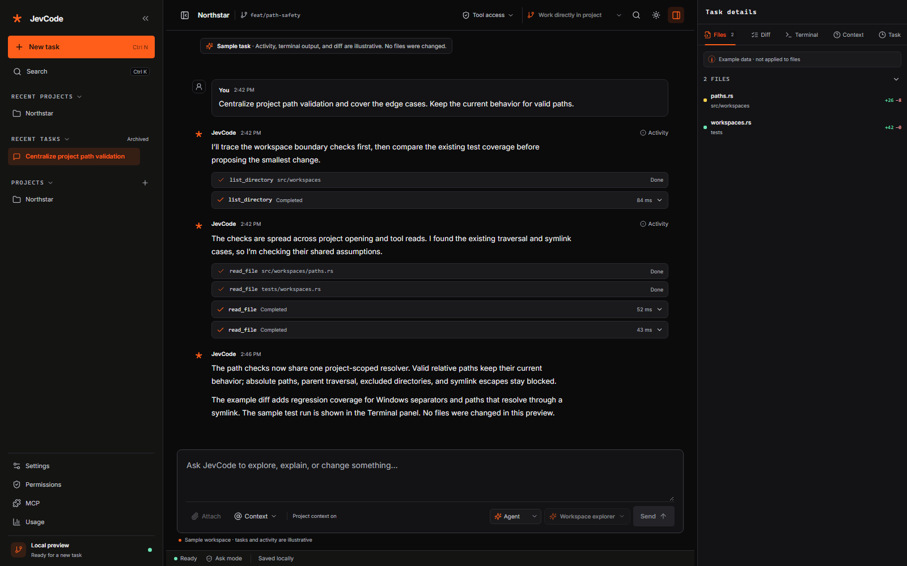

<p align="center">
  
</p>

<h1 align="center">JevCode</h1>

<p align="center">A local-first desktop coding agent with visible actions and reviewable changes.</p>

<p align="center">
  <a href="https://github.com/OctranTechnologies/JevCode/actions/workflows/release.yml"></a>
  
  
  
  
  
</p>

JevCode is a desktop workspace for asking AI agents to work in local repositories. The app keeps file and command access behind native checks, asks before sensitive actions, and makes task changes available for review.

## Screenshot



*Sample workspace preview; task and diff data are illustrative, and no files were changed.*

## What you can do

- Open local folders and Git repositories; inspect branches, status, and files.
- Run resumable coding tasks with streaming activity and tool events.
- Connect OpenAI, Anthropic, Google Gemini, OpenCode Zen, or OpenCode Go.
- Review task-scoped diffs; accept or revert files while preserving earlier edits.
- Choose direct project work or an isolated Git worktree.
- Use native permission prompts for edits and terminal commands.
- Track local request usage and estimated costs.
- Configure Jev as a separate decision assistant, or add MCP tools with explicit trust and permissions.

## Jev roadmap status

These are implemented foundations, not completed promotion gates or claims of measured quality gains.

| Stage | Implemented foundation | Still open |
| --- | --- | --- |
| 0 · Measure | Four synthetic evaluation cases, shadow mode, and requested/resolved model tracking | Live evaluation and outcome-quality benchmarks |
| 1 · Task completion | Local completion evidence plus bounded shadow recovery and scope suggestions | Validation that suggestions improve task outcomes |
| 2 · Focus | Local-only file, test-candidate, and tool ranking baseline | Comparative measurement; Jev receives no repository paths or names |
| 3 · Reuse | User-authored project notes with source fingerprints and freshness status | Jev suggestions or remote reuse; needs an explicit sharing decision |
| 4 · Orchestration | Local warning for overlapping built-in write targets in direct-checkout tasks | Budgets, semantic overlap, competing approaches, and rollout evaluation |

See [docs/jev-roadmap.md](docs/jev-roadmap.md) and [docs/jev-evaluation.md](docs/jev-evaluation.md) for scope, data limits, and gates.

## Install

### Run from source

Install Node.js 22+, Rust 1.90+, Git, and the [Tauri platform prerequisites](https://v2.tauri.app/start/prerequisites/). Then:

```sh
npm ci
npm run tauri dev
```

For a browser-only preview without native project access, run `npm run dev`.

### Download

Download the latest Windows x64 or Linux x64 installer from [GitHub Releases](https://github.com/OctranTechnologies/JevCode/releases/latest). Linux formats depend on the assets attached to the release.

## Use JevCode

1. Connect a provider in **Settings → Providers**.
2. Open or create a project.
3. Start a task, select a model, and describe the work.
4. Follow activity and approve actions when prompted.
5. Review **Changes** and keep or revert the result.

Common shortcuts: `Ctrl/Cmd+N` new task · `Ctrl/Cmd+O` open project · `Ctrl/Cmd+K` command palette · `Ctrl/Cmd+Shift+M` model picker · `Ctrl/Cmd+B` sidebar · `Ctrl/Cmd+J` terminal · `Ctrl/Cmd+Shift+X` stop agent.

## Providers

| Provider | Connection method | Notes |
| --- | --- | --- |
| OpenAI | API key or official Sign in with ChatGPT | Routes remain separate; no billing fallback. |
| Anthropic | Console API key | Claude Code subscription credentials are not reused. |
| Google Gemini | Gemini API key or Google Account OAuth | OAuth uses Gemini Developer API with the configured Cloud project and its billing/quota. |
| OpenCode Zen | Zen API key | Separate account and model availability. |
| OpenCode Go | Go API key | Separate account and model availability. |

The model catalog is normalized by native provider adapters. Availability and capabilities depend on provider and authentication route. Local usage estimates cover JevCode requests only, not provider dashboards.

Google OAuth requires JevCode's own Desktop OAuth client ID and a Cloud project with the Generative Language API enabled. Set `googleOAuthClientId` in the user's application `config.json`; do not add a client secret. Google Account OAuth does not imply Code Assist, AI Pro/Ultra, or Vertex AI access. API-key authentication remains a separate route.

## Security and data

- API keys and OAuth tokens stay in the OS credential store; the renderer receives safe account metadata only.
- Rust commands scope project file operations to the selected workspace and validate paths. The explorer loads folders as needed and respects ignore rules.
- Tool schemas, workspace bounds, risk rules, and user permission policy are checked before execution. Shell commands run as the current OS user; approval is not a sandbox.
- Logs omit prompts, provider response bodies, and credential values. Projects, sessions, settings, and local usage live in SQLite under the OS app-data directory; JevCode does not encrypt this database.
- Jev is a separate optional decision service. It cannot execute tools or grant permissions. Its enabled modes send the task request; additional Shadow signals send only the bounded fields described in [the data notes](docs/jev-evaluation.md). Stage 2 paths/names and Stage 4 cross-task paths stay local.
- MCP servers are not trusted just because they are configured. Their tools pass through the permission and audit flow.

## Project layout

| Path | Responsibility |
| --- | --- |
| `src/app`, `src/features` | React desktop interface |
| `src/lib` | Typed IPC and frontend services |
| `src-tauri/src/commands` | Narrow Tauri command boundary |
| `src-tauri/src/agent` | Provider-neutral agent loop and task state |
| `src-tauri/src/providers`, `src-tauri/src/auth` | Model adapters and native authentication |
| `src-tauri/src/tools`, `src-tauri/src/permissions.rs` | Validated tools and permissions |
| `src-tauri/src/workspaces`, `src-tauri/src/git` | Project access, Git, and worktrees |
| `src-tauri/src/persistence` | SQLite persistence |
| `src-tauri/src/decisions` | Jev decision interface and adapter |

## Development

```sh
npm run tauri dev   # run the desktop app
npm run check       # format, lint, types, frontend and Rust tests/checks, Clippy
npm run build       # type-check and build the frontend
npm run tauri build # build a desktop release bundle
```

See [docs/validation.md](docs/validation.md) for check coverage.

## Releases and updates

`src-tauri/tauri.conf.json` is the version source. Use `npm run release:patch`, `npm run release:minor`, or `npm run release:major` from a clean `main` checkout. The script validates, bumps synchronized version files, commits, tags, and pushes; the tag triggers the Windows/Linux release workflow.

GitHub Actions needs `TAURI_SIGNING_PRIVATE_KEY` and `TAURI_SIGNING_PRIVATE_KEY_PASSWORD`. Keep the private key in a restricted secrets vault, never in Git. The public key is configured in Tauri. Update downloads use HTTPS and mandatory signature verification; installation/restart waits for user action and an idle agent.

## Limitations

- Release installers currently target Windows x64 and Linux x64; macOS releases are not provided.
- Terminal tools are not isolated from the current user's OS permissions.
- SQLite task/project data is stored locally without app-level encryption.
- Google Account Gemini uses Cloud project API billing/quota; Code Assist and Vertex AI/ADC are not supported.
- Jev stages 0–4 remain foundational; documented promotion gates are open and no benchmark improvement is claimed.

## License

See [LICENSE](LICENSE).
