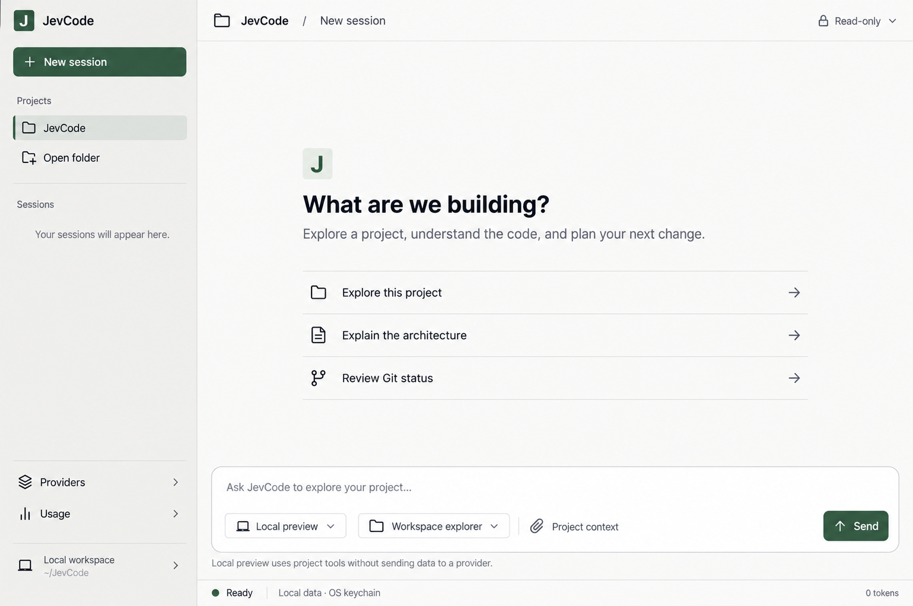
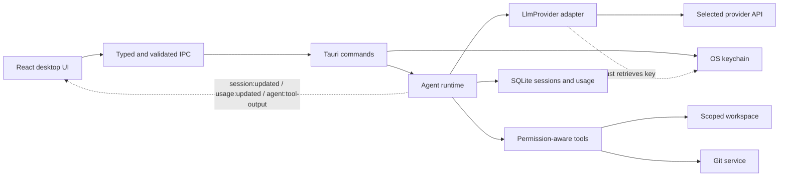

<p align="center">
  
</p>

<h1 align="center">JevCode</h1>

<p align="center">A local desktop AI coding agent for your projects, tasks, and code changes.</p>

<p align="center">
  <a href="https://github.com/OctranTechnologies/JevCode/actions/workflows/release.yml"></a>
  
  
</p>

A local desktop AI coding agent built with Tauri 2, React, TypeScript, Vite,
Tailwind CSS and Rust. Open a project, choose a provider and model, run a task,
review tool activity and diffs, approve sensitive actions, and resume the last
task when the desktop starts again.

The original repository contained only this README and a license. No incumbent
application or architecture was replaced. The initial architecture scope puts
orchestration, credentials, provider requests and local services in Rust, with
React responsible for interaction and presentation.

## Development

Prerequisites: Node.js 22+, Rust 1.90+, Git, and the
[Tauri system prerequisites](https://v2.tauri.app/start/prerequisites/).
On Windows these include Visual Studio C++ Build Tools and WebView2. Linux needs
the documented WebKitGTK/system packages; its credential store uses Secret Service.

```sh
npm ci
npm run tauri dev
```

`tauri dev` starts Vite on `127.0.0.1:1420`, compiles Rust, and opens the desktop
window. In a debug build the source repository opens automatically on the first
launch. Release builds start with an empty workspace. Use **Open folder** to add
other projects. If port 1420 is occupied, close the existing JevCode dev server;
Vite uses a fixed port so the desktop window cannot silently load the wrong app.

**Local preview** runs a deterministic adapter with real project tools and no
remote model. Try **Explore this project**, **Explain the architecture**, or
**Review Git status**. Git status asks for one-time approval by default. Preview
responses are labeled and report zero LLM tokens.

For a remote model, open **Providers**, save an API key to the OS keychain, then
start a new session and select that provider and model. A saved key indicates
presence; account access and model availability are checked on the first request.
Keys are never stored in SQLite, config files, localStorage or logs. The typed
password field holds a key briefly while saving it; Rust alone retrieves stored
credentials. Existing conversations keep their original provider and model.

`npm run dev` opens the UI in a browser for layout work. Browser mode shows a
clearly labeled sample project, task, activity, diff, and terminal output so the
workspace can be reviewed without connecting a provider. Sample actions are not
executed, and local-project, credential, and send controls require the desktop app.

## Screenshots



This is the approved design reference, not a capture of a running build. A native
runtime screenshot should be added after visual review on a supported capture host.

## Workspace interface

The main window uses a project and task sidebar, an agent activity timeline, a
task composer, and an optional right inspector for files, diffs, terminal activity,
context, and task details. The sidebar and inspector resize from their dividers;
the sidebar collapses to an icon rail. On narrower windows, the inspector and
sidebar become drawers so the conversation stays usable. The layout has been
reviewed at 1280×850, 900×640, and 618×708 browser viewports. A native desktop
screenshot and live resizing pass still need a supported capture surface.

Use **Ctrl/Cmd+N** for a new task, **Ctrl/Cmd+O** to open a project,
**Ctrl/Cmd+K** for the command palette, **Ctrl/Cmd+Shift+M** for model selection,
**Ctrl/Cmd+B** to toggle the sidebar, **Ctrl/Cmd+J** for terminal activity, and
**Ctrl/Cmd+Shift+X** to stop a running agent. The command palette lists these
actions too. Enter sends a task and Shift+Enter adds a line. The composer includes
project-local file references, project context, a model selector, and Agent / Plan
modes. Selected files are limited to the open project; the task receives their
relative paths for the existing read tool.
The inspector reports empty states in native sessions when that capability is not
available. Browser preview labels every illustrative activity and diff as sample
data.

## Projects and workspaces

Choose **Open folder** to open an existing directory (including a Git repository),
or **Create project** to make a new child folder under a selected parent. Project
roots are canonicalized in Rust and are the only handles the webview keeps; the
webview cannot read arbitrary paths. Typed commands expose project operations by
project ID, and directory reads by a project ID plus a relative path. Rust checks
containment and rejects traversal, links that escape the root, and protected
directories before reading. The file tree fetches one directory at a time, honors
Git ignore rules, and caps each listing. Project summaries use a bounded scan and
report when their repository size and language counts are partial.

The overview displays the current branch, Git working-tree state and changed
files, recent tasks, approximate repository size, detected languages, and editable
project instructions. Project IDs, canonical paths, instructions, preferred model,
permission defaults, Git root, last-opened time, and recent status are stored in
SQLite. Reopening a recent project validates its current folder and refreshes its
Git metadata. Removing a project from recents leaves its saved sessions intact.
**Reveal** opens the folder in Explorer, Finder, or the system file manager.

The overview's terminal runs a command entered directly by the user in the selected
project folder. It has an output limit and timeout. This one-shot command surface
is not registered as an agent tool. Agent tools continue to use the backend's
separate permission policy and scoped operations. Git branch switching only accepts
an existing local branch name and uses Git arguments without shell interpolation.

## Module boundaries

| Responsibility | Location | Boundary |
| --- | --- | --- |
| Desktop UI | `src/app`, `src/components`, `src/features` | Presentation, selection, draft messages, event reducer |
| Typed IPC | `src/lib/ipc.ts`, `src/lib/schemas.ts` | Command map, runtime validation, normalized errors |
| Tauri commands | `src-tauri/src/commands` | Validate input and delegate; no provider wire formats |
| Agent runtime | `src-tauri/src/agent` | Bounded tool loop, cancellation, checkpoints, approvals |
| Permissions | `src-tauri/src/permissions.rs` | Mode evaluation, command risk checks, one-time/session/project grants |
| LLM adapters | `src-tauri/src/providers` | `LlmProvider` trait; protocol encoding and normalization |
| Tool execution | `src-tauri/src/tools` | Registry, schema validation, scoped and bounded execution |
| Workspace/project management | `src-tauri/src/workspaces` | Canonical folder identities, local workspace, path checks |
| Git operations | `src-tauri/src/git` | Fixed Git CLI arguments, no shell interpolation, bounded status and local branch switching |
| Persistence | `src-tauri/src/persistence` | SQLite WAL, schema version, session/project/usage storage |
| Authentication/credentials | `src-tauri/src/credentials` | Native OS keychain through `keyring` |
| Usage tracking | `src-tauri/src/usage`, `src/features/usage` | Provider-reported tokens and request duration |
| External tool extensions | `src-tauri/src/extensions`, `src-tauri/src/mcp.rs` | Provider-neutral integration registry; MCP stdio and Streamable HTTP clients |



## MCP and tool extensions

Tool integrations use `ToolIntegration` and `ExtensionRegistry`, separate from
the `LlmProvider` adapters. The current MCP client supports the documented
stdio and Streamable HTTP transports and performs initialize, tool discovery,
and tool calls in Rust. Discovered names are namespaced and bounded; external
schemas are checked by the same JSON-schema validator as built-in tools.

User-scoped MCP configuration is stored in the local SQLite `mcp_servers`
table. Project-scoped configuration is stored in `.jevcode/mcp.json`; it contains
only server settings and environment variable names, never secret values. MCP
environment values and HTTP bearer tokens are saved under opaque keys in the OS
credential store. Local MCP commands launch as argument arrays without a shell,
with a filtered environment and discarded stderr. HTTP requires HTTPS (loopback
is allowed over HTTP), disables redirects, and applies connection and response
limits.

Every server is disabled by default. Adding or editing a server clears its trust;
the user must enable it and choose **Trust & Connect** after reviewing the
command or endpoint. Trusted servers are not started automatically on app launch.
Configuration and trust are bound by a fingerprint, so edits require a fresh
trust action. MCP tool calls are marked as external command/network operations,
go through the active task permission mode and approval flow, and appear in the
persisted task timeline. Server descriptions, tool schemas, and results are
treated as untrusted; secret values are excluded from public schemas and redacted
from returned content. Generic integrations can add browser, database, issue
tracker, documentation search, or deployment tools without coupling them to a
model provider.

The provider-neutral `AgentRuntime` owns the task state machine, context budgeting,
request retries and timeouts, tool-call limits, permission pauses, cancellation,
and scheduling. `LlmProvider` accepts normalized `ProviderRequest` values and
streams visible text while returning normalized tool calls and usage. The adapter
factory chooses a wire protocol from configuration. OpenAI Responses,
OpenAI-compatible Chat Completions, Anthropic Messages and Gemini GenerateContent
encode tool definitions and normalize their responses. Provider continuation data
is sanitized before persistence: hidden reasoning and thinking blocks are neither
displayed nor stored. Only useful task activity such as concise progress, inspected
files, and tool outcomes is exposed to the UI.

All core interfaces are in `src/types/domain.ts` and `src-tauri/src/domain.rs`:
`Provider`, `Model`, `AgentSession`, `AgentMessage`, `Tool`, `ToolCall`, `ToolResult`,
`Workspace`, `Project`, `UsageRecord`, and `PermissionPolicy`. Rust serializes
camelCase object fields and snake_case enum values. Zod validates command results
and events before they enter React state. Both languages roundtrip the same
session fixture under `tests/fixtures/session.json` to catch contract drift.

`send_message` reserves a session, persists the user message, and starts an async
run without blocking IPC. Tasks move through `queued`, `planning`, `working`,
`waiting_for_permission`, `waiting_for_user`, and a terminal state (`completed`,
`failed`, or `cancelled`). Checkpoints persist full conversation and activity
snapshots. The frontend merges snapshots by their update timestamp so an older
command response cannot overwrite a newer event. Text deltas stream as a separate
ephemeral event; the completed assistant message is persisted in the conversation.
Multiple sessions can run independently; one session cannot have competing runs.
Only tools explicitly marked parallel-safe are batched, and permission or user
questions pause the same task until it is resumed. Provider and model selection is
resolved for each task run, so switching does not require restarting the app.

The runtime defaults to 32 model iterations, 64 tool calls, two retries for
transient provider failures, a 120-second model-request timeout, and a 30-second
tool timeout. Its context budget reserves room for the model response and removes
old conversation turns as complete units. The limits and timing values are
configurable through `AgentRuntimeConfig`. `MockProvider` tests exercise streaming,
parallel tools, permission/user pauses, cancellation, persistence, and context
limits without provider credentials or API usage.

## Persistent tasks and project guidance

An agent task is a durable session, not a transient chat view. Its SQLite JSON
record stores the project/provider/model selection, title, lifecycle status,
conversation, visible activity events, permission state, Git branch or worktree,
archive state, loaded instruction sources, and structured working context.
Usage is normalized in the `usage` table by session ID. Review baselines and file
checkpoints are also keyed by session ID, so task changes remain reviewable after
restart without including changes that predated the task.

The sidebar supports renaming, archiving and resuming, deleting, duplicating, and
forking tasks. Ctrl+K searches both active and archived tasks. Duplicate starts
from the original request with fresh activity and review state; fork carries the
visible transcript and activity into an independent task with its own review
baseline. Deleting a task removes its associated usage and review records.

For long tasks, the provider receives a compact view after eight conversation
turns: the complete local transcript remains intact, every original user request
is retained verbatim in `WorkingContext.protectedInstructions`, and older
assistant/tool output is reduced to visible progress, repository facts, current
implementation state, and outstanding requests. This does not ask for, store, or
expose hidden model reasoning. Compaction events and the structured context are
saved with the task and are inspectable in the Context panel.

At task creation, Rust loads root-level `AGENTS.md` and `CLAUDE.md` files, plus
the project instructions saved in settings. Symlinked or oversized instruction
files are ignored. Their source names appear in the conversation, Context panel,
and task details so users can see which guidance was applied. The webview never
receives an unrestricted filesystem API.

## Code review and task checkpoints

Each task records its canonical project root, Git HEAD, and bounded Git status
snapshot before the first model request. Before a file tool writes, JevCode saves
that file's pre-task bytes and permissions in the local SQLite database. Before a
command runs, it snapshots non-ignored regular files in the workspace and then
compares them afterward, so formatter and test-script edits also appear in the
task review. The command snapshot is capped at 50,000 files, 512 MiB total, and
16 MiB per file; a command is not started if the baseline cannot be captured.
Git-ignored files and `.git` internals are excluded from command snapshots.

The task inspector groups added, modified, and deleted files and shows unified
diffs, line counts, staged state, pre-existing working-tree edits, and files that
changed again after the agent's write. Accepting a file marks the task change as
reviewed while keeping it visible in the task history. Reverting restores the
captured pre-task bytes; it refuses to overwrite content that changed after the
agent snapshot. Revert all preflights every changed file before restoring any of
them. Whole-file staging is available only for files without pre-existing edits,
and runs `git add` with a path argument (never shell interpolation). Reverting a
task-only staged file also removes that path from the index; pre-task staged paths
are left as captured. Checkpoint bytes stay local in SQLite alongside the
task/session records.

## Provider configuration

The catalog in `src-tauri/src/providers/defaults.json` includes:

| Provider | Protocol | Default model |
| --- | --- | --- |
| Local preview | In-process deterministic adapter | Workspace explorer |
| OpenAI | Responses | Account-specific catalog |
| Anthropic | Messages | `claude-sonnet-4-6` |
| Google Gemini | GenerateContent | `gemini-2.5-flash` |
| OpenCode Zen | OpenAI-compatible Chat Completions | `deepseek-v4-flash` |
| OpenCode Go | OpenAI-compatible Chat Completions | `deepseek-v4-flash` |

These are editable fallback entries for offline setup, not the authoritative
entitlement catalog. OpenAI has no hardcoded model fallback: JevCode retrieves
the selected credential's catalog and persists the normalized results locally.
For ChatGPT OAuth, this uses OpenAI's documented `GET /v1/models` response,
keeps only entries with `visibility: "list"`, displays `display_name`, and sends
the returned `slug` as the Responses API model. Unknown pricing, context-window,
vision and reasoning fields remain unset rather than being guessed. Other
connected providers retrieve their model list through their own adapters.
Models and provider access can change. Zen and Go are separate configured providers using
their [documented endpoints](https://opencode.ai/docs/zen/) and
[Go endpoints](https://opencode.ai/docs/go/). A gateway model requiring a different
protocol should be registered as a separate provider descriptor with that protocol.

Rust loads `<app_config_dir>/config.json` on startup, falling back to the checked-in
catalog only when the file is absent. Invalid configuration produces a startup
error rather than silently discarding settings. Copy `defaults.json` there and
edit it to add models or providers. IDs must be unique; base URLs must use HTTPS,
without embedded credentials, query strings or fragments. Redirects are disabled.
`maxToolRounds` must be between 1 and 32.

Example additional provider:

```json
{
  "id": "my-gateway",
  "name": "My gateway",
  "protocol": "open_ai_chat",
  "baseUrl": "https://gateway.example.com/v1",
  "models": [{
    "id": "coding-model",
    "provider": "my-gateway",
    "displayName": "Coding model",
    "capabilities": ["tools", "streaming"],
    "supportsTools": true,
    "supportsVision": false,
    "supportsReasoning": false,
    "supportsStreaming": true,
    "contextWindow": null,
    "inputPrice": null,
    "outputPrice": null,
    "status": "available"
  }]
}
```

For a new provider using an existing protocol, add configuration only. For a new
wire protocol, implement `LlmProvider`, register its factory and add serialization
fixtures. The UI and agent loop stay unchanged. Credentials are keyed by provider
ID and service `dev.jevcode.desktop`.

Protocol references: [OpenAI function calling](https://developers.openai.com/api/docs/guides/function-calling),
[Anthropic tool results](https://platform.claude.com/docs/en/agents-and-tools/tool-use/handle-tool-calls),
and [Gemini GenerateContent](https://ai.google.dev/api/generate-content).

## Accounts and provider authentication

The Accounts screen connects OpenAI, Anthropic, Google Gemini, OpenCode Zen and
OpenCode Go independently. Each API key is sent once over typed Tauri IPC to
Rust, checked against the provider's documented model-list endpoint, and saved
only after validation succeeds. Replacing a key with an invalid value leaves the
previous working key intact. The Models action uses the same non-generation
catalog endpoint, so a connection check does not issue a billable model request.

`src-tauri/src/auth` defines the provider-neutral `ProviderAuthAdapter` contract
for connect, disconnect, refresh, validation, account info, model discovery and
status. `OpenAIAuthManager` owns OpenAI API keys, ChatGPT sessions, model discovery,
and token refresh. `GoogleAuthManager` owns isolated Google OAuth sessions,
Gemini API keys, per-account Cloud projects, and token refresh.
`OpenAIProvider` and `GeminiProvider` are distinct native transport adapters;
the generic agent runtime asks the provider factory for an `LlmProvider` and
never reads a key or token. OpenAI and OpenCode use bearer authorization,
Anthropic uses `x-api-key`, Gemini API-key requests use `x-goog-api-key`, and
Google Account Gemini API requests use a bearer token plus
`x-goog-user-project`. Other API-key providers continue through the shared
adapter.
Zen and Go model catalog URLs are taken from their official docs. Safe account
metadata is stored in SQLite; credentials stay in the OS keychain under service
`dev.jevcode.desktop` (OpenAI ChatGPT and Google OAuth sessions each use a
separate namespaced keychain service; OpenAI entries are UUID-scoped and Google
entries are scoped by a one-way digest of the verified Google subject).

Authentication is intentionally separated by product entitlement:

- OpenAI API keys and official Sign in with ChatGPT are supported separately.
  `get_openai_auth_status` returns safe account metadata and never returns
  tokens. `openai_auth_start` creates fresh state, nonce, and PKCE values,
  binds a short-lived listener to `127.0.0.1`, and opens OpenAI's documented
  authorization URL in the system browser. First-time sign-in uses OpenAI's
  documented dynamic client registration and the identity plus plan-usage
  scopes. Reauthorization reuses the saved issued client ID and ID-token hint.
  After validating the exact `/auth/callback` loopback host and state, the
  native `OpenAIAuthManager` exchanges the code with the issued client ID,
  verifier, exact redirect URI, and `https://api.openai.com/v1` resource at
  OpenAI's documented token endpoint. It loads OpenID metadata and JWKS only from the official
  `auth.openai.com` endpoints, checks the advertised signing algorithm, and
  verifies the ID-token signature, issuer, audience, expiry, not-before time,
  issued-at time, nonce, and subject. Email is shown only when the signed token
  marks it verified. The stable local profile key derives from the verified
  subject and issued client ID.

  Access, refresh, and ID tokens are stored only in the OS credential manager
  under UUID-scoped entries in `dev.jevcode.desktop.openai`; account name,
  verified email, client ID, scopes, and timestamps are the only OAuth profile
  data stored in SQLite. Every OAuth registration is a distinct safe profile,
  even when two registrations have the same verified email. Its stable local
  profile ID (derived from the issued client ID and verified subject) scopes a
  separate keychain item, so adding or reconnecting one account cannot overwrite
  another account's credentials. The React layer receives only safe account
  state, registration labels, the selected profile ID, and the selected auth
  method. Selection and auth method persist across restarts; selecting an
  account invalidates the prior account's cached model catalog. Before each
  OpenAI request, the native adapter uses only the explicitly selected ChatGPT
  profile or API-key method. Removing the last selected ChatGPT account leaves
  ChatGPT selected and pauses requests until reconnect or an explicit switch to
  an already connected API key. OAuth errors never fall through to API-key
  billing. It refreshes within
  five minutes of expiry, respects OpenAI's `earliest_refresh_at` value, and
  serializes refreshes per account so only one request rotates tokens at a
  time. The documented form-encoded refresh grant uses that registration's
  issued client ID, refresh token and `resource=https://api.openai.com/v1`,
  omitting `scope`. JevCode saves the new access and replacement refresh tokens
  before continuing the model request, and only sends ChatGPT credentials to
  the official OpenAI Responses API host. ChatGPT-plan requests always use
  `store: false` and `stream: true`, send complete local history through
  `input`, and place JevCode function tools in the documented namespace form.
  The stream must finish with `response.completed`; rate/usage-limit, unavailable,
  unsupported-capability and incomplete-response errors remain distinct and do
  not trigger a billing-mode switch. A terminal revoked or expired refresh
  error clears the unusable credential and leaves a safe profile marked
  **Reconnect needed**. Network and service errors preserve the saved session
  and do not start a refresh retry loop. `openai_auth_status`,
  `openai_auth_refresh`, `openai_auth_select_account`,
  `openai_auth_use_api_key` and `openai_auth_logout` expose safe metadata only.
  Reconnect reuses that account's issued client ID, host ID and (only when the
  matching saved session remains valid) its ID-token hint; it omits the
  first-registration agent name. Adding an account always starts a fresh
  dynamic-client OAuth attempt. Remove tries OpenAI's discovery-advertised
  revocation endpoint with the account's refresh token, client ID, and
  `refresh_token` hint. It retries temporary network/service failures with
  bounded backoff, clears the local credential and profile either way, and
  reports whether remote revocation was confirmed. JevCode does not read
  Codex/ChatGPT credentials or browser cookies.
- Settings → Providers → OpenAI presents ChatGPT OAuth and an API key as
  separate authentication methods. ChatGPT sign-in opens the system browser;
  the page shows the waiting, cancel, reconnect, denial, timeout, network and
  provider-outage states without exposing authorization material. Account
  management displays only verified profile metadata and a stable short
  registration label for accounts sharing an email. Users can add, select,
  reconnect, or remove accounts; each selection loads that account's available
  models. API keys can be tested, replaced, disconnected, or explicitly selected
  as the request route independently of ChatGPT OAuth. A connected API key is
  never a silent fallback. Successful sign-in refreshes the selected account's
  model picker, and safe profile/selection metadata is restored on app restart.
- Anthropic Console API keys are supported. JevCode does not reuse Claude Code,
  Claude.ai or subscription OAuth credentials.
- Gemini API keys and Google Account OAuth are independent Gemini Developer API
  request routes. The OAuth route uses a Cloud project and the public
  `generativelanguage.googleapis.com` API. It does not use Gemini Code Assist
  inference: Google's Cloud AI Companion REST reference documents project,
  location, repository-index and settings operations, while the Gemini CLI's
  Code Assist integration uses Google's first-party
  `cloudcode-pa.googleapis.com/v1internal` service. Google says the Code Assist
  inference API is for Google-provided clients; JevCode does not call that
  private endpoint.
  Google's Gemini API OAuth quickstart describes a simplified setup and directs
  production apps to choose appropriate credentials. JevCode implements this
  documented OAuth path as a distinct Gemini Developer API billing route. It
  does not use Google Account OAuth to access Gemini Code Assist inference.

  To enable Google Account sign-in, create JevCode's own Desktop app
  OAuth client in Google Cloud Console and add its public client ID to the
  existing `config.json` in the app configuration directory:

  ```json
  {
    "googleOAuthClientId": "YOUR_CLIENT_ID.apps.googleusercontent.com"
  }
  ```

  In Google Auth Platform, configure the OAuth consent screen and create an
  OAuth client whose application type is **Desktop app**. While the consent
  screen is in Testing, add the accounts you intend to use as test users. A
  desktop client is a public client: configure only its client ID in JevCode;
  do not ship or enter a client secret. The callback port is chosen at runtime,
  so do not register a fixed web redirect URI.

  The client ID is public configuration; do not add a client secret or copy
  Gemini CLI credentials. Sign-in opens the system browser and uses Google's
  documented random-port IPv4 loopback redirect in the form
  `http://127.0.0.1:<port>` with the root path. The callback listener binds
  only to `127.0.0.1`, accepts one callback whose host, path, and state match
  the authorization request, then closes on success, provider error,
  cancellation, or timeout. Google documents the loopback redirect as host and
  port without an `/oauth2callback` path; JevCode uses that documented form to
  avoid redirect mismatches. Callback pages never show authorization codes or
  tokens. Sign-in also uses fresh `state` and `nonce`, and PKCE S256. JevCode
  requests `openid email profile` plus the Google-documented
  `cloud-platform` and `generative-language.retriever` scopes. These OAuth
  scopes are needed for the selected Google account to call the Gemini
  Developer API with a Cloud project. Production deployments must complete the
  applicable Google OAuth consent and scope verification requirements.
  The native layer validates the callback, granted scopes, and signed ID token
  (issuer, audience, signature, expiry and nonce) before saving the session in
  the OS credential store. After the callback, Rust sends a form-encoded POST
  to Google's official `https://oauth2.googleapis.com/token` endpoint with the
  app's `client_id`, the returned authorization `code`, the original loopback
  `redirect_uri`, the matching PKCE `code_verifier`, and
  `grant_type=authorization_code`. The desktop app does not send or embed a
  client secret. JevCode validates the bearer token response, expiry, required
  identity scopes, and Google's signed OIDC identity before marking the account
  connected. Refreshes are serialized and replace the secure session in place.
  `google_auth_status` returns a list of safe account metadata and the selected
  account ID. SQLite stores only profile, account type, expiry, scopes, project
  ID, connection state, and selected-account preference. Each verified Google
  subject gets a separate OS credential-store item; keychain labels contain a
  SHA-256 digest rather than the subject or email. App startup migrates the old
  single-session item into this account-scoped format without writing token
  values to SQLite. Adding an account starts a new browser flow with fresh
  state, nonce, and PKCE values while keeping the existing selection.
  Reconnect binds the flow to the expected subject and rejects a different
  Google account instead of replacing it.
  `google_auth_select_account` persists selection; account-specific refresh,
  project updates, and logout always carry the account ID. Removing one account
  revokes its token where possible and deletes only its credential item; other
  accounts stay connected. Removing the selected account selects a remaining
  profile, and that selection survives restart. Cloud project IDs are stored
  with their corresponding Google accounts. Selecting an account refreshes
  safe auth status and models for the active route. A Gemini provider snapshots
  the selected account and project at task start, so switching accounts cannot
  change the credentials or billing path of an in-flight task. JevCode never
  switches from Google Account to API Key implicitly. React never receives
  access, refresh, or ID tokens.
  The native auth manager refreshes an expired token or one within five minutes
  of expiry. A per-account async lock serializes refreshes, and rotated
  credentials are written back to that account's OS credential-store item.
  Revoked grants or missing refresh credentials mark only that profile **Needs
  attention**. Network failures preserve its saved session and do not trigger an
  internal retry loop. For Gemini API OAuth, the refreshed access token stays
  inside the native provider path and is sent as a bearer token with the
  selected `x-goog-user-project` header.

  Google account classification uses only a verified ID-token `hd` claim. A
  consumer account is identified as individual, but OAuth does not expose
  whether it has Google AI Pro or Ultra. The Gemini Developer API OAuth route
  requires a Google Cloud project with the Generative Language API enabled;
  requests use that project's quota and billing. Google's OAuth quickstart
  demonstrates the public `generativelanguage.googleapis.com/v1/models`
  endpoint with an `Authorization: Bearer` token and `x-goog-user-project`.
  JevCode uses the documented ListModels route under its configured Gemini
  `v1beta` API version and the public GenerateContent routes for requests.
  See the [Gemini API OAuth quickstart](https://ai.google.dev/gemini-api/docs/oauth)
  and [GenerateContent API reference](https://ai.google.dev/api/generate-content).

  Google documents Gemini for Google Cloud / Code Assist inference as an API
  developed for Google-provided clients only. JevCode does not call that service
  or Gemini CLI's internal endpoints, and does not reuse Gemini CLI OAuth
  client credentials, tokens, `gcloud` credentials, or browser cookies. OAuth
  does not expose a Google AI Pro/Ultra tier or prove Code Assist eligibility;
  JevCode does not claim those subscriptions provide quota for this API route.
  See Google's [Code Assist security documentation](https://docs.cloud.google.com/gemini/docs/codeassist/security-privacy-compliance).
  JevCode identifies consumer versus Workspace accounts from the verified
  identity, but project access, API enablement, and organization policy still
  determine whether an account can make requests.

  **Troubleshooting:** If Google sign-in is unavailable, check that the client
  ID is present in JevCode's app `config.json` and belongs to a Desktop OAuth
  client. Enable the Generative Language API for the intended project and
  configure the consent screen and scopes. If Google rejects the account before
  returning to JevCode, check the consent-screen audience, test-user list, and
  Workspace administrator policy.
  A callback verification error means the one-time attempt expired or failed
  state validation; restart sign-in instead of reusing the old browser URL. If
  the account links but no Gemini models appear, select **Use Google Account**,
  enter the associated Cloud project ID, enable the Generative Language API in
  that project, and confirm the account can use it. Google Account OAuth uses
  that project's billing and quota; it does not use Code Assist or AI
  subscription quota.

  Settings → Providers → Google Gemini offers **Continue with Google** and
  **Use Gemini API Key** as separate choices. Google Account OAuth sends
  requests to the Gemini Developer API using the selected Cloud project's
  billing and quota. A Gemini API key uses its own billing/quota route. Neither
  route silently falls back to the other. Vertex AI / ADC remains unavailable
  until a separate authentication mode is implemented. Multiple Google OAuth
  profiles are supported with isolated keychain entries; switching the selected
  identity persists across restart and does not affect an in-flight task.
  API-key credentials remain independently stored and selectable.
  Sign-in progress and cancellation appear in the settings card; cancellation,
  timeout, denied consent, browser launch, network, OAuth and reconnect failures
  use friendly messages. Unsupported accounts or Workspace policy restrictions
  are identified as possible causes when Google denies consent. Missing Cloud
  project or Gemini API setup is explained in settings. The connected view
  shows verified email metadata and the selected sign-in method, never OAuth
  tokens. Vertex AI / ADC is labeled unavailable until a later release. These
  controls use the shared semantic surface, border and status tokens, so they
  follow both warm-light and dark themes.
- OpenCode Zen and OpenCode Go use their respective API keys.

The UI receives no secret on reads: account status, account info, logout results
and available models are returned as non-secret types. Tauri commands are
explicitly allowlisted and include no command to read OAuth credentials; the
renderer can only start/cancel auth, select a safe profile, request safe status,
or request removal. Secrets are not serialized to SQLite, localStorage, JSON
configuration, source code, diagnostics or logs. Frontend log commands accept
only a small allowlist of fixed event names. Provider response bodies are never
included in errors or logs, and OAuth authorization URLs are not logged. The
loopback listeners bind only to IPv4 `127.0.0.1`, accept one correctly hosted
callback with fresh one-time state, and shut down on success, failure,
cancellation or timeout. OpenAI discovery and revocation stay constrained to
documented OpenAI hosts. Google OAuth uses Google's fixed authorization and
token endpoints; OIDC discovery and signing keys are fetched over HTTPS only
from official Google identity hosts. Both ID-token flows require supported
signatures, matching issuer and audience, expiry, nonce, and a nonempty subject.
Refresh and logout serialize per account to protect rotating refresh tokens. No
crash-report upload service is configured; local diagnostics expose app/platform
metadata only. Connection
failures map to stable categories:
invalid credential, expired authentication, quota exhausted, subscription
unavailable, network error and provider outage.

Official authentication references: [Google OAuth 2.0 for desktop apps](https://developers.google.com/identity/protocols/oauth2/native-app),
[Gemini API OAuth quickstart](https://ai.google.dev/gemini-api/docs/oauth),
[Gemini API model catalog](https://ai.google.dev/api/models),
[Gemini Code Assist security and client restrictions](https://docs.cloud.google.com/gemini/docs/codeassist/security-privacy-compliance),
[Gemini CLI authentication and account/project guidance](https://geminicli.com/docs/get-started/authentication/),
[Gemini Code Assist subscription transition](https://docs.cloud.google.com/gemini/docs/codeassist/sunset),
[OpenAI API authentication](https://developers.openai.com/api/reference/overview#authentication),
[OpenAI Sign in with ChatGPT for open-source apps](https://developers.openai.com/siwc/token-sharing-open-source/sign-in),
[OpenAI accounts, sessions and token refresh](https://developers.openai.com/siwc/token-sharing-open-source/profiles-and-sessions),
[OpenAI ChatGPT-plan models and inference](https://developers.openai.com/siwc/token-sharing-open-source/models-and-inference),
[OpenAI ChatGPT-plan Responses limitations](https://developers.openai.com/siwc/token-sharing-open-source/preview-limitations),
[OpenAI token reference](https://developers.openai.com/siwc/token-sharing-open-source/token-reference),
[OpenAI errors and recovery](https://developers.openai.com/siwc/token-sharing-open-source/errors-and-recovery),
[OpenAI OIDC discovery and ID-token verification](https://developers.openai.com/siwc/website),
[Anthropic API authentication](https://platform.claude.com/docs/en/manage-claude/authentication),
[Gemini API keys](https://ai.google.dev/gemini-api/docs/api-key),
[Google Desktop OAuth](https://developers.google.com/identity/protocols/oauth2/native-app),
[Gemini CLI authentication choices](https://geminicli.com/docs/get-started/authentication/),
[Gemini Code Assist setup](https://docs.cloud.google.com/gemini/docs/codeassist/set-up-gemini),
[Gemini Code Assist subscription changes](https://docs.cloud.google.com/gemini/docs/codeassist/sunset),
[Gemini for Google Cloud API reference](https://docs.cloud.google.com/gemini/docs/api/reference/rest),
[Gemini CLI Code Assist OAuth source](https://github.com/google-gemini/gemini-cli/blob/main/packages/core/src/code_assist/oauth2.ts),
[Gemini CLI Code Assist server source](https://github.com/google-gemini/gemini-cli/blob/main/packages/core/src/code_assist/server.ts),
[OpenCode Zen](https://opencode.ai/docs/zen/) and
[OpenCode Go](https://opencode.ai/docs/go/).

## Model management

`Model` is a provider-neutral contract shared by Rust and TypeScript: provider
and model IDs, display name, context window, capabilities, tool/vision/reasoning/
streaming support, optional input/output prices and lifecycle status. Provider
adapters normalize their own catalog responses; the UI does not contain model
names or provider-specific catalog logic. The checked-in catalog supplies only
an initial fallback. Connected providers refresh through their documented model
list endpoint: [OpenAI](https://developers.openai.com/api/reference/resources/models/methods/list),
[Anthropic](https://platform.claude.com/docs/en/api/models/list),
[Gemini](https://ai.google.dev/api/models),
[OpenCode Zen](https://opencode.ai/docs/zen/) and
[OpenCode Go](https://opencode.ai/docs/go/).

The desktop caches normalized catalogs in SQLite `model_catalogs` and preferences
in `model_preferences`; no credentials are stored in either table. Favorites,
recently used models and the workspace default survive restarts. Projects keep a
separate preferred model. The shared picker in the toolbar and composer groups by
provider, supports search and keyboard selection, and shows tool, vision,
reasoning and streaming capability marks. Changing a completed session's model
updates that session in place; the visible conversation is preserved while
opaque provider continuation data is cleared. A running or approval-waiting task
must finish before switching. Removed models are shown as unavailable until the
user selects a current catalog entry; saved defaults fall back to the next valid
project/workspace choice. Catalogs that do not report prices leave prices null.

## Local storage, permissions and errors

Tauri resolves the OS-specific app data, config and log directories. On Windows,
data/config live under `%APPDATA%/dev.jevcode.desktop`; logs live under
`%LOCALAPPDATA%/dev.jevcode.desktop/logs`. `jevcode.sqlite` stores projects, complete
session snapshots, usage records, permission mode and project permission rules;
WAL mode, foreign keys and a busy timeout are enabled. SQLite schema version 9
includes in-place migrations for workspace, authentication metadata, model catalogs,
preferences, permissions, review checkpoints and MCP configuration. Conversation
and project content are local plaintext;
provider account metadata contains no secrets, and keys are separately protected
by the OS keychain.

The conservative default is **Ask**. It allows project reads and Git inspection,
and asks before edits, terminal commands, network access, or paths outside the
workspace. **Workspace Write** allows project edits but still asks before commands
and network access. **Full Access** allows ordinary edits, commands and network
requests. Destructive commands, file deletions, credential-like paths,
outside-workspace paths and system-level operations always require fresh
approval. Agent commands cannot elevate privileges. Project settings may ask or
deny more narrowly than the workspace mode.

Approval requests offer **Allow once**, **Allow for this session**, **Always allow
for this project**, and **Deny**. Dangerous actions only offer per-call approval.
Session grants last for the task; project grants are limited to the exact operation
and appear under Settings → Permissions, where each can be revoked. Grants store a
SHA-256 operation fingerprint and a safe display summary, not raw command arguments.
The backend reclassifies every request when it resumes and never trusts a UI-provided
command classification. Denial returns an error tool result to the model. Cancellation
closes unresolved calls with error results so provider history stays valid.
Interrupted running sessions become failed on restart; pending approvals survive.
The most recently opened, non-archived task is restored when its project is still
available. Offline network status is shown in the workspace, provider request errors
update account health without persisting remote response text, and Accounts offers
revalidation for expired credentials.

The Rust tool registry is the only route from model tool calls to project files,
Git, and commands. Each tool descriptor declares a JSON schema, permission
category, risk level, timeout, and whether it is safe to batch with other calls.
The registry rejects unknown fields and invalid arguments before dispatch. Its
structured results include bounded content, pagination metadata, truncation, and
stable error codes; large files, walks, searches, diffs and command output have
explicit limits. Search uses `rg` when installed and falls back to the Rust
ignore-aware walker. Both honor `.gitignore`; credential and build directories
are excluded from search.

File tools include `read_file`, `read_files`, `list_directory`, `search_files`,
`search_text`, and `file_metadata`. Editing is incremental through unique-context
`apply_patch`; `create_file`, `delete_file`, and `move_file` are bounded to regular
files and never recursively delete directories or overwrite move destinations.
Repository context includes `git_status`, `git_diff`, `git_log`, `git_show`,
`git_branch`, `inspect_project`, `find_symbol`, and `find_references`. `run_command`
starts a program with an argument array and a validated working directory; it does
not add an implicit shell. A model can request an explicit shell interpreter, which
is classified as dangerous and needs fresh approval because static inspection cannot
predict its effects. Stdout and stderr stream into the task timeline
separately and are capped before persistence or model context. Exit status and
timeout details are returned as structured results. Cancelling a task drops the
running child process. Agent-launched processes inherit a small allowlist of
standard environment variables; provider credentials and authentication variables
are filtered out. The command tool has no interactive stdin, so commands that need
user input must run in a user-operated terminal.

Filesystem tool paths are canonicalized and limited to the active project by
default. Outside paths require an explicit grant and remain a fresh-review action
even in Full Access. Command analysis checks for recursive deletion, disk
formatting, privilege elevation, common credential locations, network access and
workspace escapes. Shell interpreters and inline code are classified as dangerous
because their effects cannot be fully inspected statically. This analysis is a
defense-in-depth prompt, not an operating-system sandbox: an approved process runs
with the desktop user's rights. A filesystem guard also cannot prevent a path from
being replaced between validation and use, and custom credential locations may
not be recognized.
Reads are UTF-8 and limited to 64 KiB per file; patches are limited to 1 MiB;
directory pages are capped at 100 visible entries. Git and process execution use
fixed argument arrays, bounded output and per-tool timeouts.

Remote requests have a 15-second connection and 120-second total timeout, a 4 MiB
response limit, and at most 16 tool calls per response. No automatic request retries
are made, avoiding duplicate billed calls. The session round limit bounds provider
iterations across approval pauses. Provider tokens and elapsed request time are
recorded on successful responses. Preview reports zero tokens. Cost stays `null`
until an explicit pricing source is implemented; failed requests may still be
billed remotely and are not represented in these successful-response totals.

Rust returns structured `{ code, message }` errors across IPC. A React error
boundary offers reload recovery; operation errors provide actionable inline copy.
`tracing` writes daily JSONL logs with timestamps, service errors and allowlisted
event names. Frontend logging accepts fixed identifiers only. Request/response bodies,
prompts, tool content and API keys are not logged. Old application-owned log files
are pruned after 30 days. Settings → Diagnostics shows app/OS/build information,
local data and log locations, provider/project/session counts, connectivity, and a
manual latest-release check. Diagnostics export is limited to those non-secret
fields. `RUST_LOG=jevcode_lib=debug` changes Rust verbosity.

The webview CSP permits local assets and Tauri IPC. Tauri capability grants only
the event listen/unlisten operations used by the UI and a folder dialog. Provider
networking, filesystem access, Git, update checks and credential retrieval stay in
Rust; general filesystem/shell plugins are not exposed to JavaScript. The update
screen checks the official JevCode GitHub latest-release endpoint with a fixed URL,
bounded response/time and redirects disabled; opening the release page uses a fixed
official URL. shadcn/ui is optional; this small foundation uses semantic native
controls and Lucide icons without introducing a component framework dependency.

## Security audit and known limits

| Area | Control in this build | Remaining limit |
| --- | --- | --- |
| API key exposure | Secrets live in OS keychain; typed IPC schemas omit secret reads; request bodies and credentials are not logged; child processes get an allowlisted environment | Project/session text and local DB are plaintext in the OS app-data directory |
| Filesystem traversal | Project IDs plus canonicalized relative paths; Rust rejects traversal and escaping symlinks; webview has no generic FS API | A link/path can race between validation and use; approved processes run with the desktop user's filesystem rights |
| Command injection | Process API receives executable and args separately; interpreter and inline-code commands receive dangerous classification and fresh approval | An approved shell script can do anything available to the current OS user; this is not a sandbox |
| Environment leakage | Agent children get a small allowlist; provider and common authentication variables are filtered; MCP stderr is discarded | Allowlisted variables can still contain machine-specific information |
| URL handling | Provider/model adapters use fixed official endpoints; MCP HTTP requires HTTPS except loopback, disallows redirects; release check validates the official GitHub host/path | A trusted server or provider still receives the data needed for its request |
| Logs | Structured logs and frontend event allowlist exclude prompts, tool output, response bodies and keys; 30-day file retention | Debug builds can include additional Rust diagnostics; users should review logs before sharing |
| Tauri permissions | Minimal event and dialog capability; no JS filesystem, shell or HTTP plugin permissions | Native Rust commands remain privileged and rely on typed inputs, project scope and tool permission checks |

Provider failures distinguish invalid/expired authentication, quota, unavailable
subscription, network errors and provider outages. Crash recovery marks in-progress
tasks interrupted and restores the latest usable task; it does not automatically
retry an interrupted billed model request.

## Validation and build

```sh
npm run lint
npm run typecheck
npm test
npm run rust:check
npm run rust:test
npm run rust:lint
npm run build
npm run tauri build
```

`npm run check` runs Rust formatting, lint, TypeScript, frontend tests, Rust checks,
Rust tests and strict Clippy.
Rust tests cover persistence, path scoping, permission enforcement, real preview
tool runs, provider normalization and the shared TypeScript fixture. Frontend tests
cover IPC schemas, stale-event protection, error redaction, keyboard shortcuts and
session restoration. There is not yet a separate packaged-app integration suite.
The approved design reference is in `docs/desktop-mockup.png`; it is not shipped as
interface pixels.

### Release builds and updates

JevCode uses the official Tauri 2 updater plugins. Release builds create signed
updater artifacts, and the Tauri GitHub Action publishes their signatures and a
`latest.json` manifest to the GitHub release. In release builds, JevCode checks
for updates after the desktop bootstrap and main interface have rendered, then
every 12 hours. Settings → Updates stores preferences in SQLite: automatic checks
are on by default, automatic downloads are off, and Stable is the only channel.
Available releases appear in a compact banner; an up-to-date check stays quiet.
The banner and Settings → Updates render release notes as a small, safe Markdown
subset; raw HTML is escaped and links are shown as text, so updater metadata is
never injected into the WebView. For each available version, choose **Update Now**,
**Remind Me Later** (shown again after 24 hours), or **Skip this version**. These
choices persist in SQLite across restarts; a newer version clears an old
reminder or skip. A subtle dot marks an update that is still pending. When a
download has completed, the app offers **Restart and Update**. If JevCode closes
before installation, it checks again and downloads the signed package on the next
launch to restore the ready state. When enabled, automatic downloads run in the
background and show progress. The user must explicitly install and restart, and
JevCode blocks those actions while any task is queued, running, streaming, or
waiting for input or approval. The current Tauri 2 JavaScript updater API does
not expose cancellation for an in-progress download. Settings → Updates and
About both provide a manual check. Update checks are disabled in development
builds. Tauri verifies each bundle against the public key in
`src-tauri/tauri.conf.json`, and the app restarts after installation when the
platform requires it. Signed-version verification is enabled too, so the manifest
cannot pair a valid package signature
with a forged version number. The updater also validates release metadata before
presenting it. Missing, invalid, or modified package signatures are rejected before
installation and shown as a concise error; raw plugin errors are not displayed.

The production endpoint is the HTTPS GitHub Releases static manifest at
`https://github.com/OctranTechnologies/JevCode/releases/latest/download/latest.json`.
The Tauri updater selects an installer-specific target before its generic
OS/architecture fallback. The manifest contract for the artifacts we publish is:

| Installation | Generic target | Installer target | Signed update bundle |
| --- | --- | --- | --- |
| Windows x64 MSI | `windows-x86_64` | `windows-x86_64-msi` | MSI |
| Windows x64 NSIS | `windows-x86_64` | `windows-x86_64-nsis` | NSIS setup executable |
| Linux x64 AppImage | `linux-x86_64` | `linux-x86_64-appimage` | AppImage |
| Linux x64 Debian | — | `linux-x86_64-deb` | `.deb` |
| Linux x64 RPM | — | `linux-x86_64-rpm` | `.rpm` |

The generic Windows entry intentionally prefers MSI (`updaterJsonPreferNsis: false`);
the app's installed bundle type selects the corresponding installer-specific
entry when available. Tauri selects `{os}-{arch}-{bundle_type}` before its
generic `{os}-{arch}` fallback, so AppImage, Debian, and RPM installations use
their own signed update bundles. The generic Linux entry points to AppImage as
the fallback. The release validator requires exactly these seven Windows and Linux targets,
checks that their HTTPS GitHub API asset URLs belong to the release, confirms
each asset has the expected bundle type and an uploaded `.sig` file, and checks
that generic entries match their configured preferred targets. Tauri performs
cryptographic signature verification on the client; signed-version verification
binds the package signature to its manifest version. Downgrades are disabled. GitHub's
`latest` route excludes drafts and prereleases, and the release workflow rejects
a tag that is not newer than every published stable release.

After the release quality gate and updater-key preflight pass, the workflow creates
a stable draft. A test, signing, platform bundle, or manifest failure prevents the
publish job from running, leaving the draft out of the production endpoint. A
draft is promoted only after Windows and Linux pass.
See the official [Tauri updater guide](https://v2.tauri.app/plugin/updater/),
[GitHub pipeline guide](https://v2.tauri.app/distribute/pipelines/github/),
and [tauri-action manifest generator](https://github.com/tauri-apps/tauri-action/blob/dev/src/upload-version-json.ts)
for the updater format and release tooling.

#### GitHub Actions release procedure

`src-tauri/tauri.conf.json` is the single source of truth for the app version,
following the [Tauri versioning recommendation](https://v2.tauri.app/distribute/#versioning).
The release commands synchronize that version to `package.json`,
`package-lock.json`, `src-tauri/Cargo.toml`, and the JevCode entry in
`src-tauri/Cargo.lock`. `npm run version:check` verifies all six version fields;
the release workflow runs the same check against the pushed tag before preparing
a draft.

Commit your application changes to `main`, make sure the working tree is clean,
then preview or run one of these commands:

```sh
npm run release:patch -- --dry-run
npm run release:patch
# or: npm run release:minor / npm run release:major
```

The release command verifies that local `main` matches `origin/main`, calculates
the next stable semantic version, synchronizes all version files, and runs
`npm run check`. A failed check restores the version files and stops before any
release commit or tag is created. After successful checks it commits the version
bump, creates an annotated tag such as `v0.2.0`, pushes `main`, and then pushes
the tag. The tag starts `.github/workflows/release.yml`:

```text
npm run release:patch
  → version files synchronized and checks pass
  → version commit and vX.Y.Z tag pushed
  → GitHub Actions builds Windows and Linux
  → signed updater artifacts and signatures generated
  → complete GitHub Release published
  → existing installations detect the update
```

The workflow validates that the tag matches every app version file, passes the
release quality gate, confirms the updater signing key is configured, and is
newer than all published stable releases before it creates a draft. A test,
platform build, signing, or manifest validation failure leaves the release
unpublished. If pushing the tag fails after the version commit reaches
`origin/main`, push the reported tag with `git push origin vX.Y.Z` to resume the
release.

Configure these repository Actions secrets before the first release:

- `TAURI_SIGNING_PRIVATE_KEY`: the complete private updater key contents.
- `TAURI_SIGNING_PRIVATE_KEY_PASSWORD`: the key password, or an empty value for
  an unencrypted key.

Add them in the repository's **Settings → Secrets and variables → Actions**.
The signing key must be available to the release workflow before pushing a
version tag; the workflow checks this before creating a draft.

`GITHUB_TOKEN` is provided by GitHub Actions and is scoped to release contents;
no personal access token is needed. The signing key is only passed to the
preflight and Tauri build steps and is never printed. Keep the private key out of Git, application
configuration, logs, and checked-in `.env` files. The public verification key in
`src-tauri/tauri.conf.json` is safe to commit.

The pipeline builds Windows x64 and Linux x64 installers with the official
`tauri-apps/tauri-action@v1`. Its Linux quality job
runs `npm run check` (formatting, lint, type checks, frontend tests, Rust checks,
Rust tests and Clippy) before a draft is created. Each platform job must produce
its installer and every updater bundle/signature it needs. The Windows job
installs and verifies the VBScript Windows capability required by WiX MSI
packaging. The action uploads installers,
updater packages, `.sig` files, and `latest.json` to the draft. Platform jobs run
one at a time so the action can merge entries without racing on `latest.json`.
The final job finds the draft in the authenticated release collection (GitHub's
release-by-tag endpoint can return 404 for drafts), then runs
`scripts/validate-updater-release.mjs` against its assets and downloaded manifest.
It rejects missing platforms, wrong bundle types, unattached URLs, or missing
signature assets. Only then does it publish the release as stable and latest.
Failed matrix jobs prevent the final
publish job from running, so incomplete drafts are never served by the stable
endpoint. If a failed run is retried, the workflow removes the assets from its
tag's existing draft before rebuilding, avoiding stale or duplicate platform
files.

### Update failure behavior and data safety

Network failures, GitHub outages, missing metadata, invalid JSON and unavailable
assets leave the installed app and its user database alone. Invalid or corrupted
packages fail Tauri signature verification before installation. Installation
errors are shown without exposing raw installer paths or plugin details. If the
app closes during a download, app-data preferences record the requested version;
on the next launch JevCode checks and downloads it again. Partial bytes are not
resumed. Repeated checks are serialized. Tasks may continue while a package
downloads, but install/restart is blocked while a coding task is active. Older or
repeated stable tags are blocked before draft creation; GitHub's latest stable
endpoint excludes drafts and prereleases, and a failed platform build cannot
publish.

Projects, tasks, usage and preferences live in the OS app-data directory in
`jevcode.sqlite`, outside the application install directory. Provider credentials
remain in OS credential storage. The updater replaces application bundles and
does not migrate or delete these stores. SQLite migrations run when the updated
app starts; updater failures do not issue project or session deletion commands.

For the hosted release check, signed stable releases `v0.1.0` and `v0.1.1` were
built and published successfully. The `v0.1.0` Windows installer download matched
the GitHub asset SHA-256 and installed into an isolated test folder. Launching it
from the Codex execution sandbox failed before the UI opened because that sandbox
grants read-only access to the Windows app-data directory used by SQLite. The
user database hash remained unchanged. The installed-app update, restart, and
data-retention path therefore still needs a run outside that sandbox. These first
test releases used the previous Windows/macOS/Linux matrix; future releases build
Windows and Linux only. Automated tests and CI gates cover release
metadata, downgrade rejection, interrupted downloads, signature failures,
active-task protection, and publication preconditions; these checks do not
substitute for a hosted installation test.

Windows Authenticode installer signing requires a maintainer certificate and is
not configured here. Updater artifact signing remains enabled independently.

For a local signed Windows build in PowerShell, point the documented environment
variable at the private key file outside the repository, then run the Tauri build:

```powershell
$env:TAURI_SIGNING_PRIVATE_KEY = "$env:USERPROFILE\.tauri\jevcode-updater.key"
$env:TAURI_SIGNING_PRIVATE_KEY_PASSWORD = ""
npm run tauri build -- --bundles nsis
Remove-Item Env:TAURI_SIGNING_PRIVATE_KEY
Remove-Item Env:TAURI_SIGNING_PRIVATE_KEY_PASSWORD
```

The NSIS updater bundle and its adjacent `.sig` file are written under
`src-tauri/target/release/bundle/nsis/`. Keep the key in a restricted-access
encrypted password manager or secrets vault and keep a separate encrypted offline
backup. Limit access to release maintainers, retain recovery instructions, and
periodically confirm the backup can be restored without copying the key into the
repository. Losing or replacing this key requires rotating the configured public
key and will prevent existing installations from accepting releases signed with
the old key. A GitHub draft release becomes available to the updater only after
publication. Updater package signing is separate from Windows Authenticode.

Provider adapters are covered by offline protocol fixtures. Live API calls require
user credentials and have not been certified against every provider account/model.
Official third-party OAuth for ChatGPT subscriptions, Claude Code subscriptions,
and Gemini account access remains disabled unless the provider offers JevCode an
official supported client flow. Provider-account billing is not imported; local
usage estimates are explicitly separate from provider dashboards.

## Local usage dashboard

The Usage screen is labeled **Local Agent Usage** and records each model request
attempt made by this application, including failed attempts and retries. Records
are stored in the local SQLite usage table and include timestamp, provider,
model, project, task, input/cached-input/output token counts, latency, result and
an optional estimated cost. Older records remain readable; missing legacy fields
are normalized when loading them.

Estimated costs are calculated in one backend registry at
`src-tauri/src/usage/pricing.rs`. Registry rates use USD per million tokens and
are updated independently of dashboard aggregation. The bundled OpenAI,
Anthropic and Gemini model rates come from their published API pricing; other
models use normalized prices from the provider model catalog when available.
Requests without a known rate keep a null estimate instead of showing a made-up
amount. Cached-input rates are applied when the provider reports cached tokens.

The dashboard does not import provider-account totals. Its note and exports
explicitly distinguish application telemetry from provider billing, which may
include activity outside JevCode, subscription allowances, discounts, or other
pricing conditions. CSV and JSON exports include all locally stored request
records, including their success state and any known pricing estimate.

The maintained default-model pricing references are [OpenAI GPT-5.4 mini API
pricing](https://developers.openai.com/api/docs/models/gpt-5.4-mini),
[Anthropic Claude Sonnet 4.6 pricing](https://www.anthropic.com/news/claude-sonnet-4-6),
and [Google Gemini API pricing](https://ai.google.dev/gemini-api/docs/pricing).
