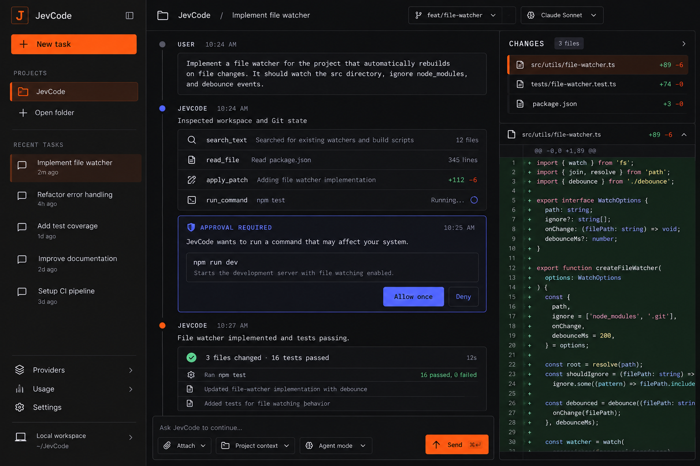

<p align="center">
  
</p>

<h1 align="center">JevCode</h1>

<p align="center">A desktop coding agent that works in your projects and keeps every change reviewable.</p>

<p align="center">
  <a href="https://github.com/OctranTechnologies/JevCode/actions/workflows/release.yml"></a>
  
  
</p>

JevCode is a local-first AI coding workspace built with Tauri 2, React,
TypeScript, Vite, and Rust. Open a project, give the agent a task, approve
sensitive actions, and review its changes before keeping them.

## Preview



*Interface concept preview; the image is a mockup, not a capture of the running application.*

## Features

- **Projects:** open local folders and Git repositories, browse files lazily, and view branch and working-tree status.
- **Tasks:** resume conversations, inspect activity, and keep project instructions such as `AGENTS.md` in context.
- **Multiple providers:** select models from connected providers without changing the agent runtime.
- **Jev decision assistance:** configure TypeSafe Jev separately from chat providers. Stage 1 adds a completion checklist, bounded recovery hints, and scope warnings. Stage 2 records a local-only baseline for relevant files, discovered test files, and available tools. Project memory adds user-reviewed local notes with source freshness, edit, pin, and delete controls. Neither feature sends its file shortlist or saved memory to Jev or coding providers.
- **Controlled tools:** repository reads, edits, Git actions, and commands pass through validation and permission checks.
- **Change review:** inspect diffs, accept or revert files, and preserve modifications that existed before a task.
- **Isolated worktrees:** optionally run concurrent tasks in separate Git worktrees.
- **Usage:** review request, token, latency, and estimated-cost data generated by JevCode.
- **MCP:** connect user or project tools explicitly; configured servers are not trusted automatically.
- **Signed updates:** Windows and Linux releases use the Tauri updater with signed artifacts.

## Install and run

### Run from source

Prerequisites: Node.js 22+, Rust 1.90+, Git, and the [Tauri system prerequisites](https://v2.tauri.app/start/prerequisites/).

```sh
npm ci
npm run tauri dev
```

The Tauri command starts Vite, compiles the Rust backend, and opens JevCode.
For a browser-only sample preview, use `npm run dev`; sample actions do not
access local projects or call providers.

### Download a release

Get the latest Windows x64 or Linux x64 installer from
[GitHub Releases](https://github.com/OctranTechnologies/JevCode/releases/latest).
Linux packages include AppImage, Debian, and RPM formats where provided by the
release.

## Start a coding task

1. Open **Providers** and connect an account or API key.
2. Open a project folder, or create a project.
3. Start a task, choose a model, and describe the change.
4. Review the agent's activity and approve actions that require permission.
5. Inspect the **Changes** panel; accept or revert files when ready.

Useful shortcuts: `Ctrl/Cmd+N` new task, `Ctrl/Cmd+O` open project,
`Ctrl/Cmd+K` command palette, `Ctrl/Cmd+Shift+M` model picker,
`Ctrl/Cmd+B` sidebar, `Ctrl/Cmd+J` terminal, and `Ctrl/Cmd+Shift+X` stop agent.

## Providers and account routes

| Provider | Supported connection | Notes |
| --- | --- | --- |
| OpenAI | API key or official Sign in with ChatGPT | Separate request routes; no silent billing fallback. |
| Anthropic | Anthropic Console API key | Claude subscription credentials are not reused. |
| Google Gemini | Gemini API key or Google Account OAuth | OAuth requires a Cloud project; usage uses that project's API quota and billing. |
| OpenCode Zen | Zen API key | Uses Zen's documented service and model catalog. |
| OpenCode Go | Go API key | Separate provider configuration and model availability. |
| Local preview | No account | Deterministic, non-LLM sample tasks. |

Models are normalized by provider adapters and grouped in the shared picker.
Catalog availability and capabilities depend on the connected account and
provider. JevCode does not claim that local estimates represent activity on a
provider's website or subscription dashboard.

### Google Account setup

Google Account sign-in uses the public Gemini Developer API, **not** Gemini Code
Assist inference. It requires JevCode's own Desktop OAuth client ID and a Google
Cloud project with the Generative Language API enabled. Add the client ID to
JevCode's user `config.json`:

```json
{
  "googleOAuthClientId": "YOUR_CLIENT_ID.apps.googleusercontent.com"
}
```

Create the client as a **Desktop app** in Google Cloud Console. Configure the
OAuth consent screen and test users as needed. Do not create or ship a client
secret. Google Account requests use the selected project's billing and quota;
Google AI Pro/Ultra or Code Assist subscription entitlement is not inferred.
API-key and Google Account routes stay separate. Vertex AI / ADC is not yet
available.

## Security and local data

- Provider keys and OAuth tokens are kept in the operating system credential store. React receives safe account metadata, never raw credentials.
- Project file access is mediated by Rust commands scoped to the selected project. Paths are canonicalized, traversal is rejected, and the explorer respects Git ignore rules.
- Agent tools pass schema, permission, workspace-boundary, and risk checks. Commands run with the current user's OS permissions; approval does not create a system sandbox.
- Agent subprocesses receive a filtered environment. Structured logs exclude prompts, provider response bodies, and credential values.
- Projects, tasks, conversations, checkpoints, preferences, and local usage are stored in SQLite under the OS application-data directory. This database is local and is not encrypted by JevCode.
- MCP servers require explicit enablement and trust, then use the same task permission and audit flow as built-in tools.

The Usage page is labeled **Local Agent Usage**. Its token counts and cost estimates
describe requests made by JevCode only; they are not complete provider-account
usage or billing totals.

## Architecture

| Area | Location | Responsibility |
| --- | --- | --- |
| Desktop UI | `src/app`, `src/components`, `src/features` | Workspace, task timeline, settings, and panels |
| IPC boundary | `src/lib/ipc.ts`, `src/lib/schemas.ts` | Typed Tauri commands, validation, and normalized errors |
| Native commands | `src-tauri/src/commands` | Validate input and delegate to backend services |
| Agent runtime | `src-tauri/src/agent` | Provider-neutral streaming, tools, cancellation, limits, and task state |
| Providers and auth | `src-tauri/src/providers`, `src-tauri/src/auth` | Model adapters, catalogs, authentication, and native credential access |
| Tools and permissions | `src-tauri/src/tools`, `src-tauri/src/permissions.rs` | Scoped filesystem, Git, process execution, validation, and approvals |
| Projects and Git | `src-tauri/src/workspaces`, `src-tauri/src/git` | Canonical project roots, repository metadata, and worktrees |
| Persistence | `src-tauri/src/persistence` | SQLite schema, projects, tasks, preferences, and usage |
| Extensions | `src-tauri/src/extensions`, `src-tauri/src/mcp.rs` | MCP and future provider-neutral tool integrations |
| Decision service | `src-tauri/src/decisions` | Typed decision interface and Jev adapter, separate from chat providers and runtime |
| Updater | `src/services/updater.ts`, Tauri updater plugin | Signed update checks, download state, and installation |

Provider-specific request formats stay in native adapters. The agent runtime
uses a shared provider interface; model names and credentials are not embedded
in the conversation UI.

Jev is a separate optional decision service, not a coding-model provider. Its
Off, Shadow, Advisory, and Assisted modes are independent from the selected
coding model. Enabled modes send the current request to TypeSafe; repository
file contents, diffs, terminal output, and raw command/search arguments are not
sent. In Shadow mode, Jev can additionally receive a bounded completion summary
(request items, workspace-relative changed-file paths, and aggregate test
outcomes), up to three candidate paths for scope checks, and one repeated failed
tool category/count for a recovery hint. Stage 2 currently creates a local-only
focus baseline from observed workspace paths, test-like filenames, and the
task's available tools. Stage 2 filenames and tool names are not sent to Jev.
Project Overview also supports concise user-authored project notes. Notes are
stored in the local SQLite database, show their workspace-relative source and
freshness, and can be edited, pinned in the local list, or deleted. A changed
or missing source is visibly marked. Pinned notes are not included in task
context, and project-memory text and source paths are not sent to Jev or coding
providers in this stage. Avoid saving secrets, credentials, raw tool output, or
large code blocks.
Jev-generated Stage 1 suggestions appear as advisory task activity only. Jev
never runs tools, changes permissions, blocks or reverts edits, or claims a test
passed. The local task receipt keeps actual changed-file
and test evidence separate from Jev's tentative labels. Advisory records a
task-category suggestion. Assisted mode can add fixed-choice workflow/context
guidance to the coding-model request and reorder eligible tool definitions, but
never removes tools, runs actions, or changes permission checks. The current
request and project instructions remain in context. Jev usage is stored
separately from coding-provider usage and shown in its own Usage page section
without merging provider totals or inventing a cost estimate. A user-triggered
synthetic evaluation baseline records the Jev model version and answer matches
without reading or sending project data; see
[docs/jev-evaluation.md](docs/jev-evaluation.md) for the exact Stage 1 payload
limits, Stage 2 local baseline, Stage 3 local memory foundation, and privacy
boundaries.
If Jev is offline, times out, or returns an invalid decision, Jev guidance is
omitted and the task continues through the normal agent path. Mock-driven tests
cover this fallback, mode-off behavior, cancellation, and unchanged permissions.

## Development checks

```sh
npm run check       # version, format, lint, types, frontend tests, Rust checks/tests, Clippy
npm run build       # TypeScript and production frontend bundle
npm run tauri build # desktop release bundle
```

`npm run tauri dev` is the normal desktop development command. See
[docs/validation.md](docs/validation.md) for validation notes and test coverage.

## Releases and updates

`src-tauri/tauri.conf.json` is the app version source. The release scripts keep
the package and Cargo version files synchronized, run checks, commit a version
bump, create a `vX.Y.Z` tag, and push `main` plus the tag:

```sh
npm run release:patch
# or: npm run release:minor / npm run release:major
```

The tag starts `.github/workflows/release.yml`, which builds Windows and Linux,
signs updater artifacts, validates the draft assets and `latest.json`, then
publishes only after all required checks pass. Set these repository Actions
secrets before releasing:

- `TAURI_SIGNING_PRIVATE_KEY`
- `TAURI_SIGNING_PRIVATE_KEY_PASSWORD`

The private signing key must stay outside Git and be backed up in an encrypted
secrets vault with access limited to release maintainers. The public
verification key is in `src-tauri/tauri.conf.json`. Updates are delivered over
HTTPS and signature verification is mandatory. JevCode never silently restarts
while a task is active; the user confirms installation and restart.

## Current limitations

- Published installers target Windows x64 and Linux x64; macOS releases are not currently provided.
- Approved terminal commands run as the current OS user and are not sandboxed.
- SQLite stores local project and task content without application-level encryption; credentials remain separate in the OS credential store.
- Google Account Gemini requests require a configured Cloud project and use its API billing/quota. Code Assist inference and Vertex AI / ADC are not supported routes.
- Provider requests require the user's own supported account or key. Local usage estimates do not include activity outside JevCode.
- Windows installer Authenticode signing is not configured; updater package signatures are separate and enabled.

## License

See [LICENSE](LICENSE).
